  <picture>
    <source media="(prefers-color-scheme: dark)" srcset="./dark.svg">
    <source media="(prefers-color-scheme: light)" srcset="./light.svg">
    
  </picture>

## Hi, I'm Mauro 👋

Software Engineer based in **Beira, Mozambique**, working across full-stack development, networks and systems, and data & GIS. Currently at **Data4MOZ**.

---

## 🎯 Focus

- **Full-Stack Development**: building complete applications, from interface to data
- **Networks and Systems**
- **Data and GIS**

---

## 🚀 Featured Projects

| Project | Description | Stack |
| --- | --- | --- |
| [portfolio-mauro](https://github.com/maurobernardo/portfolio-mauro) | Personal portfolio | TypeScript |
| [Sistema de Gestão de Biblioteca](https://github.com/maurobernardo/Sistema-de-Gesto-de-Bibiloteca-) | Library management system | Java |

---

## 🛠️ Engineering Stack

`TypeScript` · `Java`

---

<h2 align="center">📊 GitHub Contributions</h2>

  <picture>
    <source
      media="(prefers-color-scheme: dark)"
      srcset="https://raw.githubusercontent.com/maurobernardo/github-snake/output/github-snake-dark.svg"
    />

    <source
      media="(prefers-color-scheme: light)"
      srcset="https://raw.githubusercontent.com/maurobernardo/github-snake/output/github-snake.svg"
    />

    
  </picture>

---

## 📫 Connect

- 🌐 Portfolio: [mauro-zibanee.vercel.app](https://mauro-zibanee.vercel.app/)
- 🐙 GitHub: [@maurobernardo](https://github.com/maurobernardo)
